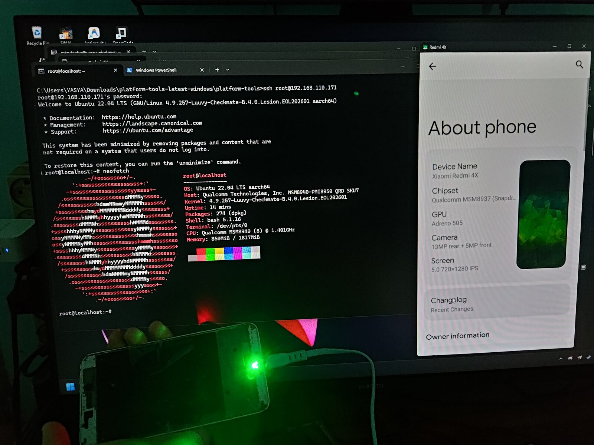
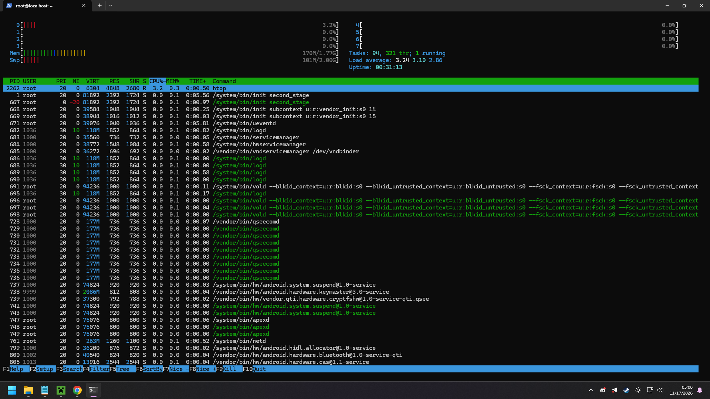

# santoni — headless Ubuntu 22.04 VPS

> An Android 10 base (keepQASSA Sisu v2.4_0.s) stripped down to a headless
> server, with an Ubuntu 22.04 chroot that comes up on every boot and sshd
> reachable over the LAN. No Android UI, no launcher, no display server.

This is **not** a phone ROM and it is **not** vanilla keepQASSA. The Android
side exists only to boot the kernel, bring up Wi-Fi and host the chroot. 37 UI
APKs are removed from the image, Zygote and SurfaceFlinger are stopped at boot,
and the backlight is turned off. What you get is a 24/7 arm64 Linux box on a
Redmi 4X.

---

## Quick Reference

| Key | Value |
|-----|-------|
| **What it is** | Headless Ubuntu 22.04 VPS on Android 10 |
| **Base** | keepQASSA Sisu v2.4_0.s (Android 10 / Q) |
| **Device** | Xiaomi Redmi 4X (santoni) |
| **SoC** | Qualcomm MSM8937 (Snapdragon 435) |
| **Lunch** | `qassa_santoni-userdebug` |
| **Build command** | `mka installclean && mka qassa` |
| **Build type** | UNOFFICIAL |
| **Current release** | [`v1.1.1`](https://github.com/ziachi/santoni_qassa_ubuntu/releases/tag/v1.1.1) — `0a809b0` |
| **Signed with** | `vendor/ziachi-keys/releasekey` |
| **SELinux** | Permissive (required by the chroot, see Hard Rule #2) |
| **Kernel** | Luuvy C.4.0.eol202601 — prebuilt, Linux 4.9.257 arm64 |
| **Manifest** | `https://github.com/keepQASSA/manifest.git` branch `Q` |
| **Maintainer** | [@kalomakan](https://t.me/kalomakan) / [ziachi](https://github.com/ziachi) |

---

## Default Credentials & First-Time Login

Every account below ships with a **known default password**, so a fresh install
is reachable without a console. Change all of them on first login.

| Account | Where | Default password | Change it with |
|---|---|---|---|
| `root` — Ubuntu chroot, SSH port 22 | `ssh root@<device-ip>` | `santoniadmin` | `passwd` |
| `ubuntu` — non-root, `sudo` NOPASSWD | `ssh ubuntu@<device-ip>` | `ubuntu` | `passwd` |
| ADB over Wi-Fi, port 5555 | `adb -s <device-ip>:5555 shell` | `santoniadmin` | see below |

```bash
# root and ubuntu, over SSH
ssh root@<device-ip>   'passwd'
ssh ubuntu@<device-ip> 'passwd'

# ADB over Wi-Fi — change it over USB, where no password is needed
adb shell "echo 'my-new-password' > /data/adb_wifi_pass && chmod 600 /data/adb_wifi_pass"
```

`vps-setup` accepts `UBUNTU_ROOT_PASS` to override the root default at install
time, and writes the value to `/data/ubuntu_root_pass` (mode 600) so it stays
discoverable over USB.

> **Do not leave these defaults in place on a device reachable from a network
> you do not control.** Port 5555 is a root shell and port 22 is root SSH. The
> defaults exist so the first login works, not so they can stay.

---

## ⚠️ Security Notice & Official Source

The only official source for this project is:

**https://github.com/ziachi/santoni_qassa_ubuntu**

If you got a build, a ZIP, or a "repack" from anywhere else — a Telegram
channel, a file host, a mirror, a fork under a different name — treat it as
untrusted and verify it before you flash it.

Why this matters: a headless server image is an attractive target. A modified
build can ship a crypto miner, a hidden reverse shell, or a tracker, and the
device still boots and behaves normally. It just runs hot, drains battery, and
sends traffic you never asked for. The `vps-setup/` components are published
under a strict source-available license — see
[vps-setup/LICENSE](vps-setup/LICENSE) — specifically so that repacks like that
are not permitted.

Before flashing anything you did not build yourself:

- Check the commit hash against this repository.
- Check the SHA256 of the ZIP against the release notes.
- Read `vps-setup/`. It is small, and it is the part that runs as root.

---

## What this is, and what it is not

| | |
|---|---|
| **Is** | A headless arm64 Linux server. Ubuntu 22.04 in a chroot at `/data/ubuntu`, sshd on port 22, Wi-Fi managed without the Android framework. |
| **Is** | Debloated. 37 APKs that only exist to draw something are removed from the image, including `SystemUI`, `Launcher3`, `Settings`, `Contacts`, `Dialer`, `LatinIME`, `GCam` and `XiaomiAddon`. |
| **Is** | Custom signed, SELinux permissive, ADB as root over USB and Wi-Fi. |
| **Is not** | A daily-driver phone ROM. There is no launcher, no status bar, no camera app, no dialer. |
| **Is not** | Vanilla keepQASSA. The device tree, the boot script, the Wi-Fi path and the package list are all modified. |
| **Is not** | A container host. The kernel has no PID/UTS/IPC/USER namespaces, so Docker, LXC and podman cannot run. Plain `chroot` is fully supported. |

---

## Proof



A Windows PowerShell session on the LAN, `ssh root@<device-ip>`, running
`neofetch` inside the chroot. The phone is on the desk beside it, powered over
USB with the charge LED on.

| Field | Value |
|---|---|
| Kernel | `4.9.257-Luuvy-Checkmate-B.4.0.Lesion.EOL202601 aarch64` |
| OS | Ubuntu 22.04 LTS aarch64 |
| Host | Qualcomm MSM8940-PMI8950 QRD SKU7 |
| CPU | Qualcomm MSM8940 (8) @ 1.401GHz |
| Memory | 850MiB / 1817MiB |
| Packages | 274 (dpkg) |
| Shell | bash 5.1.16 |
| Terminal | `/dev/pts/0` |
| Device | Xiaomi Redmi 4X — MSM8937, Adreno 505, 5.0" 720x1280 IPS |

`/dev/pts/0` is the line worth reading twice. It means the session got a real
pty, which is the v31 devpts fix working: a chroot without devpts mounted
cannot allocate one, and `ssh -tt` fails with
`PTY allocation request failed on channel 0` even though the password was
accepted.

The panel on the right is the device's own `About phone` screen, included for
the hardware summary. It reports `MSM8937` where the kernel reports `MSM8940`;
both are the same Snapdragon 435 family, and the device tree targets `msm8937`.

### Idle footprint



`htop` inside the chroot, 31 minutes after boot, with nothing running. The
process list is the Android host's, not the chroot's — a chroot shares the PID
namespace, so `htop` sees `init`, `vold`, `netd` and the HAL services.

What matters is what is **not** in the list: no `zygote`, no `system_server`,
no `app_process`, no `com.android.*`. The framework is stopped, which is the
whole point of this build.

| Field | Value |
|---|---|
| Uptime | 00:31:13 |
| Tasks | 94, 321 threads, 1 running |
| Memory | 170M / 1.77G |
| Swap | 101M / 2.00G |
| Load average | 3.24 3.10 2.86 |
| CPU | 7 of 8 cores at 0.0%, one at 3.2% |

The load average looks high next to an idle CPU. Load average counts processes
in uninterruptible sleep as well as runnable ones, and the Android HAL services
sit in that state; the CPU bars are the honest number for actual work.

## Repository Map

All custom repos for this build. Clone each into the matching path inside the
Qassa source tree.

```
~/qassa/                                    <- ROM source root
|-- .repo/                                  <- repo tool metadata
|-- device/xiaomi/santoni/                  <- THIS REPO (device tree)
|-- vendor/xiaomi/                          <- Vendor blobs (repo root holds santoni/)
|-- kernel/xiaomi/msm8937/                  <- Kernel headers (REQUIRED, see below)
|-- frameworks/base/                        <- Framework patches (custom)
|-- vendor/qassa/                           <- ROM vendor config (from repo sync)
|-- vendor/ziachi-keys/                     <- Signing keys (NOT on GitHub)
|-- build/                                  <- Build system (from repo sync)
|-- external/chromium-webview/              <- Webview (needs git-lfs pull!)
`-- out/                                    <- Build output (~200GB)
```

| Repo | GitHub URL | Branch | Clone Path |
|------|-----------|--------|------------|
| **Device tree** | [santoni_qassa_ubuntu](https://github.com/ziachi/santoni_qassa_ubuntu) | `main` | `device/xiaomi/santoni` |
| **Vendor blobs** | [vendor_xiaomi_santoni_qassa](https://github.com/ziachi/vendor_xiaomi_santoni_qassa) | `qassa-ubuntu` (base `10.0`) | `vendor/xiaomi` |
| **Kernel headers** | [kernel_xiaomi_msm8937_qassa](https://github.com/ziachi/kernel_xiaomi_msm8937_qassa) | `qassa-ubuntu` (base `10`) | `kernel/xiaomi/msm8937` |
| **Framework** | [frameworks_base_qassa](https://github.com/ziachi/frameworks_base_qassa) | `qassa-10` | `frameworks/base` |

> **Signing keys** (`vendor/ziachi-keys`) are NOT on GitHub. Generate your own or ask the maintainer.

---

## Full Setup Guide (from scratch on a new VPS)

### Prerequisites

- **OS:** Ubuntu 22.04+ (or WSL2 on Windows)
- **CPU:** 6+ cores recommended (Ryzen 5 7600 or similar)
- **RAM:** 16GB+ (22GB+ recommended for -j10)
- **Disk:** 250GB+ free space
- **Packages:** OpenJDK 8, Python 3, git, git-lfs, ccache, repo

```bash
# Install build dependencies (Ubuntu 22.04)
sudo apt update && sudo apt install -y \
    bc bison build-essential ccache curl flex g++-multilib gcc-multilib \
    git git-lfs gnupg gperf imagemagick lib32ncurses5-dev lib32readline-dev \
    lib32z1-dev liblz4-tool libncurses5 libncurses5-dev libsdl1.2-dev \
    libssl-dev libxml2 libxml2-utils lzop pngcrush rsync schedtool \
    squashfs-tools xsltproc zip zlib1g-dev openjdk-8-jdk python3

# Install repo tool
mkdir -p ~/bin
curl https://storage.googleapis.com/git-repo-downloads/repo > ~/bin/repo
chmod a+x ~/bin/repo
echo 'export PATH=~/bin:$PATH' >> ~/.bashrc
source ~/.bashrc

# Setup ccache (optional but recommended)
echo 'export USE_CCACHE=1' >> ~/.bashrc
echo 'export CCACHE_DIR=~/.ccache' >> ~/.bashrc
source ~/.bashrc
ccache -M 40G
```

> On Ubuntu 24.04 the package names differ: `lib32ncurses5-dev` becomes
> `lib32ncurses-dev`, `libncurses5-dev` becomes `libncurses-dev`, and
> `libncurses5` does not exist (only `libncurses6`). The prebuilt clang still
> needs `libncurses.so.5`, so install the bionic debs from
> `archive.ubuntu.com/ubuntu/pool/main/n/ncurses/` and run `sudo ldconfig`.

### Step 1: Initialize ROM Source

```bash
mkdir -p ~/qassa && cd ~/qassa
repo init -u https://github.com/keepQASSA/manifest.git -b Q --depth=1
repo sync -j8 --force-sync --no-tags --no-clone-bundle
```

> Initial sync takes 1-3 hours depending on internet speed. ~70GB download.

### Step 2: Clone Custom Repos

```bash
cd ~/qassa

# Device tree
rm -rf device/xiaomi/santoni
git clone https://github.com/ziachi/santoni_qassa_ubuntu.git \
    device/xiaomi/santoni -b main

# Vendor blobs — the repo root holds a single santoni/ directory, so clone it
# one level up. Cloning into vendor/xiaomi/santoni doubles the path and lunch
# fails with "vendor/xiaomi/santoni/santoni-vendor.mk" does not exist.
rm -rf vendor/xiaomi
git clone https://github.com/ziachi/vendor_xiaomi_santoni_qassa.git \
    vendor/xiaomi -b qassa-ubuntu

# Kernel headers — REQUIRED, even though the boot image is prebuilt.
# Soong's generated_kernel_includes module runs
# "make -C kernel/xiaomi/msm8937 headers_install", and external/tinycompress
# plus hardware/qassa/interfaces/cryptfshw/1.0 consume the output. Without
# this checkout the build stops at 1% with
# "make: *** kernel/xiaomi/msm8937: No such file or directory. Stop."
# The boot image still comes from prebuilts/kernel/Image.gz-dtb
# (Luuvy C.4.0), so nothing built here reaches the device.
rm -rf kernel/xiaomi/msm8937
git clone https://github.com/ziachi/kernel_xiaomi_msm8937_qassa.git \
    kernel/xiaomi/msm8937 -b qassa-ubuntu

# Framework patches (on top of synced frameworks/base)
cd frameworks/base
git remote add ziachi https://github.com/ziachi/frameworks_base_qassa.git
git fetch ziachi
git checkout ziachi/qassa-10
cd ~/qassa
```

### Step 3: Fix Webview (IMPORTANT - build will fail without this)

```bash
cd ~/qassa/external/chromium-webview
git lfs pull
# Verify webview.apk is ~40MB+, NOT a tiny LFS pointer file:
ls -lh prebuilt/x86_64/webview.apk
cd ~/qassa
```

> `external/chromium-webview` is split into five sub-repos by the keepQASSA
> manifest. Run `git lfs pull` inside each `prebuilt/*`, not in the parent.

### Step 4: Setup Signing Keys

Generate your own keys if you don't have the maintainer's keys:

```bash
mkdir -p ~/qassa/vendor/ziachi-keys
cd ~/qassa/vendor/ziachi-keys
for key in releasekey platform shared media networkstack testkey; do
    subject="/C=ID/ST=Java/L=Jakarta/O=Qassa/OU=Android/CN=${key}"
    openssl genrsa 2048 2>/dev/null | \
        openssl pkcs8 -topk8 -inform PEM -outform DER -nocrypt -out ${key}.pk8
    openssl req -new -x509 -sha256 -key <(openssl rsa -inform DER -in ${key}.pk8 2>/dev/null) \
        -out ${key}.x509.pem -days 10000 -subj "${subject}" 2>/dev/null
done
cd ~/qassa
```

### Step 5: Build

```bash
cd ~/qassa
source build/envsetup.sh
lunch qassa_santoni-userdebug
mka qassa -j$(nproc)
```

> First build: ~4-8 hours (6-core). Subsequent builds with ccache: ~1-3 hours.
>
> Output: `out/target/product/santoni/qassa_ubuntu22-ziachi-santoni.zip`

### Step 6: Flash

```bash
# Boot into TWRP recovery, then sideload:
adb sideload out/target/product/santoni/qassa_ubuntu22-ziachi-santoni.zip

# OR copy ZIP to device and flash from TWRP file manager
```

---

## Build Commands Cheat Sheet

| Command | Purpose | Time |
|---------|---------|------|
| `source build/envsetup.sh` | Load build environment | instant |
| `lunch qassa_santoni-userdebug` | Select device/variant | instant |
| `mka qassa -j10` | Full build (10 threads) | 1-8 hr |
| `mka installclean` | Clean product output, keep cache | instant |
| `mka clean` | Full clean (delete entire out/) | instant |
| `rm -rf out/soong/.bootstrap` | Fix Soong cache errors | instant |

### Background build with logging:
```bash
nohup mka qassa -j10 > /tmp/build.log 2>&1 &
tail -f /tmp/build.log          # monitor
grep -i "error\|fail" /tmp/build.log  # check errors
```

> `lunch` must not be piped. `lunch ... | tail -3` runs it in a subshell, so
> `TARGET_PRODUCT` never reaches the parent shell, `VendorVars` in
> `out/soong/soong.variables` ends up empty, and Soong dies with
> `unknown variable '$(PATH_OVERRIDE_SOONG)'`. Redirect instead:
> `lunch ... >/dev/null 2>&1`.

---

## What is in the image

### Shipped

| Item | Path | Description |
|-----|------|-------------|
| BusyBox | `busybox/busybox` | static aarch64 1.37.0 — `udhcpc` and `wget` |
| `curl` | built from `external/curl` | HTTPS downloader for `vps-setup` |
| `wifi` | `wifi/wifi.sh` | `wpa_cli` + `udhcpc` front-end |
| `vps-setup` | `vps-setup/vps-setup.sh` | one-command Wi-Fi + Ubuntu install |
| `ubuntu-enter` | `ubuntu-enter/` | adb shell wrapper with the Wi-Fi password gate |
| `init.ubuntu.sh` | `rootdir/init.ubuntu.sh` | boot script, installed to `/system/bin` |
| `init.ubuntu.rc` | `rootdir/init.ubuntu.rc` | init service, installed to `/system/etc/init` |
| `webcam_bridge` | `webcam-bridge/` | Camera2 NDK to MJPEG |
| `sensor_bridge` | `sensor-bridge/` | `ASensorManager` to a log file |
| `pulse-default.pa` | `audio-bridge/` | PulseAudio config only |

### Removed from the image

37 APKs are dropped through `LOCAL_OVERRIDES_PACKAGES` on the `RemovePackages`
stub in `prebuilts/Android.mk`. The list covers every APK that only exists to
draw something for a human:

```
Aperture AudioFX Calendar Contacts DeskClock Dialer DocumentsUI
DownloadProviderUi EasterEgg EmergencyInfo ExactCalculator FMRadio Gallery2
GamingMode GCam Launcher3 Launcher3QuickStep LatinIME LiveWallpapersPicker
MatLog messaging MusicFX OneTimeInitializer PowerOffAlarm Provision Settings
SettingsIntelligence ShadyQuickStep SoundPickerPrebuilt StorageManager
SystemUI VpnDialogs WallpaperBackup WallpaperCropper WallpaperPicker2
XiaomiAddon XiaomiParts
```

`GCam` and `XiaomiAddon` are on that list. They are **not** in the image — a
headless build has no UI to show them in, and Zygote is stopped at boot so they
could never run.

Deliberately kept: `framework-res`, `telephony-common`, `WcnssService`, the
providers (`SettingsProvider`, `MediaProvider`, `TelephonyProvider`, ...), the
telephony/modem stack (`TeleService`, `Telecom`, `ims`, `qcrilmsgtunnel`, `Stk`,
`MmsService`, `CellBroadcastReceiver`) and the network services
(`InProcessNetworkStack`, `SoftAPManager`, `WfdService`, `OsuLogin`,
`PlatformCaptivePortalLogin`).

### Why the `PRODUCT_PACKAGES` filter-out is gone

`qassa_santoni.mk` used to strip the UI with
`PRODUCT_PACKAGES := $(filter-out SystemUI Launcher3 ...)`. That never worked.
`inherit-product` is deferred in this tree (`build/make/core/product.mk:378`):
it appends a `$(INHERIT_TAG)<path>` marker instead of including the makefile, so
at that point the variable holds only markers and the filter matches nothing.
`get_build_var PRODUCT_PACKAGES` still lists `SystemUI`, `Launcher3`,
`Launcher3QuickStep` and `XiaomiAddon` for that reason.

The APKs are removed by `LOCAL_OVERRIDES_PACKAGES` on the `RemovePackages` stub
in `prebuilts/Android.mk`. `build/make/core/main.mk:1110-1112` filters the
overridden names out of `PRODUCTS.<mk>.PRODUCT_PACKAGES` before install, so they
never reach the image. `PRODUCT_PACKAGES_REMOVE` does not exist in this tree.

The stub has to be installed for the override to apply, so `RemovePackages` is
listed in `PRODUCT_PACKAGES` in `device.mk`. Keep the two lists in sync. A name
that does not match a module is harmless — the override silently does nothing —
so the list can be extended without risk.

> `debloat/` is not the debloat mechanism. It holds a single Dolby stub
> manifest and nothing else.

---

## Headless VPS Mode

The build is a headless server: no Android UI, no display server, no boot
animation. Everything is driven over ADB, then over SSH.

### Quick start

From a freshly flashed device to an SSH session, in order:

```bash
# 1. USB — no RSA prompt, adbd is already root
adb devices
adb shell id                      # uid=0(root)

# 2. USB — join Wi-Fi and install Ubuntu 22.04 in one command
adb shell vps-setup "MyWiFi" "MyWiFiPassword"

# 3. note the IP the script prints, then move to Wi-Fi ADB
adb connect <device-ip>:5555
echo 'santoniadmin' | adb -s <device-ip>:5555 shell id

# 4. vps-setup already set a random root password and printed it
#    (it is also in /data/ubuntu_root_pass if you missed it)

# 5. from any machine on the LAN
ssh root@<device-ip>
```

Steps 1-2 need the cable. After step 2 the device is self-sufficient: it
rejoins Wi-Fi and starts Ubuntu on every boot, so steps 3-5 work over the
network from then on.

| Change | Where |
|---|---|
| `androidboot.selinux=permissive` | `BoardConfig.mk` (`BOARD_KERNEL_CMDLINE`) |
| 37 UI APKs dropped, including `SystemUI`, `Launcher3`, `Settings`, `Contacts`, `Dialer`, `LatinIME`, `GCam`, `XiaomiAddon` | `prebuilts/Android.mk` (`LOCAL_OVERRIDES_PACKAGES` on `RemovePackages`) |
| `surfaceflinger`, `vendor.hwcomposer-2-1`, `zygote`, `zygote_secondary` stopped at boot, backlight 0 | `rootdir/init.ubuntu.sh` |
| Wi-Fi through `wpa_cli` + busybox `udhcpc`, no `cmd wifi` / `svc wifi` | `wifi/wifi.sh`, `wifi/udhcpc.script` |
| `service surfaceflinger` kept enabled | `rootdir/init.target.rc` |
| `service bootanim` kept enabled, `debug.sf.nobootanimation=1` | `rootdir/init.target.rc`, `qassa_santoni.mk` |
| ADB over USB without the RSA prompt, ADB over Wi-Fi on 5555 | `qassa_santoni.mk` (`PRODUCT_PROPERTY_OVERRIDES`) |

Both services are redefined with the init `override` keyword, which replaces the
AOSP definition from `system/core/rootdir/init.rc`. `init.target.rc` is imported
from `init.qcom.rc`, which `init.rc` imports after its own service definitions,
so the override lands in the right order.

> **SurfaceFlinger stays enabled on purpose.** An earlier revision disabled it
> to save RAM. That is not safe: `system_server` binds to the display path and
> the camera HAL allocates graphic buffers through it, so a missing
> SurfaceFlinger is a bootloop risk, not a saving. The headless part of this
> build comes from the missing UI APKs, not from a missing display server.
>
> `bootanim` also stays enabled, but `debug.sf.nobootanimation=1` makes it exit
> immediately, so nothing is drawn and init still gets its
> `service.bootanim.exit` handshake.

### ADB Access

| Property | Value | Effect |
|---|---|---|
| `persist.sys.usb.config` | `adb` | USB gadget exposes adb only (no MTP) |
| `persist.service.adb.enable` | `1` | adbd starts at boot |
| `ro.adb.secure` | `0` | no RSA authorisation prompt |
| `ro.secure` | `0` | adbd runs as root |
| `ro.debuggable` | `1` | debuggable build |
| `service.adb.tcp.port` | `5555` | adbd also listens on TCP 5555 |

```bash
# Over USB — no on-screen confirmation needed
adb devices
adb shell

# Over Wi-Fi, once the device is on the network
adb connect <device-ip>:5555
adb -s <device-ip>:5555 shell
```

> **Debug-phase access only.** `ro.adb.secure=0` and `ro.secure=0` mean anyone
> who can reach port 5555 is root once they pass the gate. That is deliberate
> while the device sits on the bench on a trusted LAN, and it is not a shipping
> configuration. `ubuntu-enter` runs with `DEBUG_NO_PASSWORD=0`, so the Wi-Fi
> password gate is active: USB lands straight in, Wi-Fi asks for the password.

### Login shell: `ubuntu-enter`

`persist.sys.adb.shell=/system/bin/ubuntu-enter` makes every adb session go
through a dual-auth wrapper:

| Connection | Behaviour |
|---|---|
| USB attached (`/sys/class/android_usb/android0/state` = `CONFIGURED`) | straight in, no password |
| Wi-Fi only (`DISCONNECTED`) | `ADB Wi-Fi Password:` prompt, 3 tries, then the session is closed |
| `DEBUG_NO_PASSWORD=0` (current) | gate active — the two rows above apply |
| `DEBUG_NO_PASSWORD=1` | prompt skipped on every transport — debug only, never ship |
| Ubuntu installed (`/data/ubuntu/bin/bash`) | `chroot /data/ubuntu /bin/bash -l` as root |
| Ubuntu not installed | drops to `/system/bin/sh` with a hint to run `vps-setup` |

Default password: **`santoniadmin`**. It is read from `/data/adb_wifi_pass`,
which `vps-setup` and `init.ubuntu.sh` create on first boot as `0600 root:root`:

```bash
# change it (over USB, no password needed)
adb shell "echo 'my-new-password' > /data/adb_wifi_pass && chmod 600 /data/adb_wifi_pass"
```

Scripted access over Wi-Fi is gated too, so feed the password on stdin:

```bash
echo 'santoniadmin' | adb -s <device-ip>:5555 shell getprop ro.product.model
```

> **Requires the adb patch.** AOSP hard-codes the adb shell to
> `/system/bin/sh`; `persist.sys.adb.shell` is only honoured after
> `patches/apply-adb-shell-override.py` has been applied to the synced source.
> See [patches/README.md](patches/README.md).

> **Security:** port 5555 gives a root shell to anyone who can reach it. The
> password gate is the only thing in front of it — firewall 5555 to trusted
> networks if the device is ever exposed.

### Changing the ADB Wi-Fi password

The password lives in `/data/adb_wifi_pass` (mode 600, owner `root:root`).
Change it over USB, where no password is required:

```bash
adb shell "echo 'my-new-password' > /data/adb_wifi_pass && chmod 600 /data/adb_wifi_pass"
```

The file is read on every Wi-Fi session, so no reboot is needed. Check that the
new value is accepted and the old one is not:

```bash
echo 'my-new-password' | adb -s <device-ip>:5555 shell id   # works
echo 'santoniadmin'    | adb -s <device-ip>:5555 shell id   # 3 tries, then closed
```

Forgot it? Delete the file over USB and the default `santoniadmin` comes back.
`init.ubuntu.sh` recreates it with `0600 root:root` on the next boot:

```bash
adb shell rm -f /data/adb_wifi_pass
```

### First setup (USB)

Flash the ROM, plug in USB, then run one command:

```bash
adb shell vps-setup "MyWiFi" "MyWiFiPassword"
```

It does eight things:

1. `/system/bin/wifi connect <SSID> <PASSWORD>` — brings `wlan0` up, starts
   `wpa_supplicant` when needed, adds the network through `wpa_cli` and saves
   the credentials to `/data/vps_wifi.conf`. `svc wifi` and `cmd wifi` are not
   used: both go through `system_server`, which the boot script stops.
2. wait up to 45s for an IPv4 address on `wlan0`, read with
   `ip -4 addr show wlan0`
3. download `ubuntu-base-22.04-base-arm64.tar.gz` to `/data/local/tmp/`
4. `tar -xzf` it into `/data/ubuntu` and create `dev`, `dev/pts`, `proc`,
   `sys`, `tmp`, `run`
5. write `/etc/resolv.conf` (8.8.8.8, 1.1.1.1) and an `apt` `sources.list` for
   `ports.ubuntu.com`
6. create `/data/adb_wifi_pass` with `santoniadmin` if it is missing, then
   `chmod 600` and `chown 0:0`, and print the value
7. mount `/dev`, `/proc` and `/sys` inside the chroot, write a `resolv.conf`,
   then `apt update && apt install -y openssh-server` and unmount again
8. set the root password to `santoniadmin` (or `$UBUNTU_ROOT_PASS`), `chpasswd`
   it into the chroot, verify the hash landed in `/etc/shadow`, save it to
   `/data/ubuntu_root_pass` (0600 root:root) and set `PermitRootLogin yes` in
   `sshd_config`

`curl` is built into the image from the in-tree `external/curl` module, so the
download normally happens on the device. If it is missing (an older build), the
script prints the `adb push` recipe instead of failing silently:

```bash
curl -LO https://cdimage.ubuntu.com/ubuntu-base/releases/22.04/release/ubuntu-base-22.04-base-arm64.tar.gz
adb push ubuntu-base-22.04-base-arm64.tar.gz /data/local/tmp/
adb shell vps-setup "MyWiFi" "MyWiFiPassword"
```

After that, `adb shell` lands in Ubuntu as root with `openssh-server`
installed, the root password set, and `PermitRootLogin yes` written into
`sshd_config`. The script prints both passwords at the end:

```
  Passwords, also stored on the device (mode 600 root:root):
    adb over Wi-Fi : santoniadmin
                     /data/adb_wifi_pass
    ssh root       : santoniadmin
                     /data/ubuntu_root_pass
```

`PermitRootLogin yes` is required because Ubuntu 22.04 defaults to
`prohibit-password`, which refuses root password logins even after
`passwd root`. To use a key instead, put it in
`/data/ubuntu/root/.ssh/authorized_keys` and set `PermitRootLogin
prohibit-password` back.

### Boot behaviour

`init.ubuntu.rc` starts `vps-boot` from `on boot`, which runs
`/system/bin/init.ubuntu.sh`:

```sh
service vps-boot /system/bin/init.ubuntu.sh
    class late_start
    user root
    group root system
    oneshot
    disabled

on boot
    start qrngp
    start vps-boot
```

The trigger used to be `on property:sys.boot_completed=1`. That property is only
set once the framework finishes booting, and on a device with nothing to boot
for it can stay unset for a long time — the first boot after a data wipe spends
minutes in dex2oat. `on boot` runs after `/data` is mounted and after Zygote has
started, which is all this needs. `qrngp` is started explicitly because it
normally waits on `sys.boot_completed`, which never arrives once Zygote is
stopped below, and sshd wants the entropy.

| Step | What it does |
|---|---|
| Wake lock | `echo vps_server_lock > /sys/power/wake_lock` — the SoC never suspends |
| ZRAM | checks `/sys/block/zram0/disksize`; resizes to 2147483648 bytes and `mkswap` + `swapon` when it differs |
| Password file | creates `/data/adb_wifi_pass` with `santoniadmin` when missing, then `chmod 600` + `chown 0:0` |
| Headless | `stop surfaceflinger`, `stop vendor.hwcomposer-2-1`, `stop zygote`, `stop zygote_secondary`, then `echo 0 > /sys/class/leds/lcd-backlight/brightness` |
| Mounts | `rbind` `/dev` + `make-rslave`, devpts only when the rbind did not bring it, then `/proc` and `/sys` |
| sshd prerequisites | creates `/data/ubuntu/tmp` (1777) and `/data/ubuntu/run/sshd` (0755) |
| SSH | `chroot /data/ubuntu /usr/sbin/sshd` after `ssh-keygen -A`; the Debian init script behind `service ssh start` expects systemd and fails silently. `/run/sshd.pid` is removed first, because `/run` lives on `/data` and a stale PID there would name an unrelated process |
| Wi-Fi (background) | launched with `&` once sshd is listening: `ip link set wlan0 up`, `wifi reconnect` when `/data/vps_wifi.conf` exists, `wifi dhcp` to start the udhcpc daemon, then the default route and the chroot's `resolv.conf` |

`/dev` is rbind-mounted rather than bind-mounted because ueventd keeps creating
nodes after boot; a plain bind would freeze the chroot's view at the moment of
the mount. `--make-rslave` keeps an unmount inside the chroot from propagating
back into Android's `/dev`. The mount syntax is probed once at boot: toybox
takes `-o rbind` / `-o rslave`, util-linux takes `--rbind` / `--make-rslave`,
and busybox is used when the built-in mount understands neither.

`fstab.qcom` already asks for `zramsize=2147483648`, so the ZRAM step is
normally just a check — it exists for a device that booted with the old 1 GB
fstab.

The headless step runs before the Wi-Fi step on purpose. `wificond`'s
`ClientInterfaceImpl` destructor calls `SetUpState(false)` when its client
(`system_server`) dies, so stopping Zygote takes `wlan0` down; the Wi-Fi step
brings it back up and re-selects the saved network afterwards. Joining a network
before the stop would be undone by `ClientModeImpl`, which disconnects any
network it does not know about.

The Wi-Fi step itself runs in the background, after sshd is listening. A router
that is off at boot makes `wifi reconnect` sit through its 20 s supplicant wait
and its 30 s association wait, and `wait_ip` another 45 s, so running it in the
foreground would hold the rest of the boot for up to 95 s. sshd does not need
the network to listen, so the script starts it first, launches the bring-up with
`&`, and returns. The default route and the chroot's `resolv.conf` are written
by that background job once the lease arrives, which is also why they are no
longer part of the chroot section.

`stop` does not fire `onrestart`, so nothing restarts the four services. They
are `class main`, and `class_start main` only runs once, at boot.

init sends a service's stdout to `/dev/null`, so `adb logcat -s vps-boot` and
`dmesg | grep vps-boot` both come back empty even when the script ran. The
script keeps its own log instead, capped at 64 KB:

```bash
adb shell cat /data/ubuntu-boot.log
```

The last lines say whether sshd actually came up: `sshd started` followed by
`sshd listening on :22`, or `sshd is NOT listening on :22` when it did not.

### Wi-Fi helper: `wifi`

`cmd wifi` and `svc wifi` are shell front-ends for `system_server`, and
`system_server` is stopped at boot. `wifi` is a short front-end for
`/vendor/bin/wpa_cli` and busybox `udhcpc`, installed to `/system/bin/wifi`:

```sh
adb root
adb shell wifi scan
adb shell wifi connect aeqaeqa <password>
adb shell wifi status
adb shell wifi disconnect
adb shell wifi reconnect
adb shell wifi dhcp
adb shell wifi help
```

| Command | What it does |
|---|---|
| `scan` | `wpa_cli scan` then `scan_results`; raw `bssid / frequency / signal level / flags / ssid` lines |
| `connect <ssid> [pw]` | brings `wlan0` up, starts `wpa_supplicant` when needed, adds the network, waits for `wpa_state=COMPLETED`, saves the credentials, starts the udhcpc daemon and prints the IP |
| `reconnect` | the same, using `/data/vps_wifi.conf` |
| `disconnect` | `wpa_cli disconnect`, then flushes the address |
| `status` | `wpa_cli status` plus the IPv4 address |
| `dhcp` | starts the udhcpc daemon when it is not already running |

All of it needs root, so run `adb root` first.

`wpa_supplicant` runs without `-c`, so it has no config file and `save_config`
has nowhere to write. `connect` therefore keeps the credentials in
`/data/vps_wifi.conf` (0600), and `init.ubuntu.sh` replays them on every boot.

The lease is renewed by `busybox udhcpc` in daemon mode, with
`/system/bin/udhcpc.script` as the hook. The hook never flushes the address, so
a renewal that fails leaves the device reachable on its old address instead of
taking it off the network.

`wifi dhcp` treats `/data/udhcpc.wlan0.pid` as a hint, not a fact: `/data`
survives a reboot, so the PID in a stale file can belong to an unrelated
process. It reads `/proc/<pid>/cmdline` and only skips the start when that
process really is `udhcpc`.

Inside the chroot the same CLI is available as `/usr/local/bin/wifi`. It chroots
back into Android's root, so `/proc` has to be mounted — the boot script does
that.

The `WifiShellCommand` backports in `patches/` are no longer used by anything.
They stay in the tree because they are harmless.

### Troubleshooting

| Symptom | Cause | Fix |
|---|---|---|
| `vps-setup: no IP on wlan0, check SSID/password` | wrong SSID or password, or a 5 GHz-only AP | re-run with the exact SSID — santoni is 2.4 GHz only |
| `wifi: add_network failed` | `wpa_supplicant` is not running, or `/vendor/bin/wpa_cli` is missing from the image | `adb shell getprop init.svc.wpa_supplicant` must print `running`; `wpa_cli` needs a build that lists it in `PRODUCT_PACKAGES` |
| `wifi: no /data/vps_wifi.conf, run 'wifi connect'` | the device has never joined a network, so the boot script has nothing to replay | `adb shell wifi connect <ssid> <password>` once; the file is written from then on |
| `vps-setup: no downloader on the device` | `curl` is missing from the image | use the `adb push` recipe the script prints, or rebuild with `curl` in `PRODUCT_PACKAGES` |
| `adb connect` → `connection refused` | adbd not listening yet, or wrong IP | `adb shell getprop service.adb.tcp.port` must be `5555`; read the IP with `adb shell ip -4 addr show wlan0` |
| Wi-Fi ADB asks for a password you do not know | `/data/adb_wifi_pass` was changed | over USB: `adb shell cat /data/adb_wifi_pass`, or delete the file to fall back to `santoniadmin` |
| `vps-setup` prints `/bin/sh: 1: apt-get: not found` | the chroot inherited Android's `PATH`, which has no `/usr/bin` | fixed in #52; on an older build run `chroot /data/ubuntu /bin/sh -c 'export PATH=/usr/local/sbin:/usr/local/bin:/usr/sbin:/usr/bin:/sbin:/bin; apt-get update && apt-get install -y openssh-server'` |
| `bash: groups: command not found` inside the chroot | `/etc/profile` in ubuntu-base sets `PS1` but not `PATH`, so the chroot keeps Android's `PATH` | fixed in #53; on an older build run `export PATH=/usr/local/sbin:/usr/local/bin:/usr/sbin:/usr/bin:/sbin:/bin` |
| `apt` says `Temporary failure resolving 'ports.ubuntu.com'` | the chroot is unmarked, so it uses the main routing table, which on Android holds only the local subnet plus an `unreachable default` | fixed in #53; `vps-setup` and `init.ubuntu.sh` copy the `wlan0` gateway into the main table. To repair a running device: `ip route add default via <gateway> dev wlan0` |
| `chpasswd` exits 0 but the password is still rejected | PAM inside the chroot cannot complete the change, so nothing is written to `/etc/shadow` | write the hash directly, which skips PAM: `adb shell "chroot /data/ubuntu /usr/sbin/usermod -p '<sha512-crypt-hash>' root"`. Keep the single quotes and do not wrap this in `bash -c`: the hash contains `$`, and a second parse expands `$6`, `$salt` and the leading part of the digest, storing a truncated string that no password can match. Generate the hash with `openssl passwd -6 -salt santoni <password>` |
| SSH still rejects a correct password after the hash is in `/etc/shadow` | PAM inside the chroot cannot complete authentication, usually because `/dev` or `/proc` is not mounted, so `pam_unix` and `pam_loginuid` fail | set `UsePAM no` in `/etc/ssh/sshd_config` and restart sshd; it then compares the password itself with `crypt()` and loads no PAM modules. Confirm the account is not locked with `chroot /data/ubuntu /usr/bin/passwd -S root`, which prints `P` for a usable password |
| SSH says `Permission denied (publickey,password)` | `PermitRootLogin` is still `prohibit-password`, or `chpasswd` never applied the hash | over USB: `adb shell "chroot /data/ubuntu /bin/bash -c 'echo root:santoniadmin | /usr/sbin/chpasswd'"`, then confirm `grep ^root: /etc/shadow` shows a hash and not `!` |
| SSH says `Connection refused` after a reboot | sshd never started. On builds before `c82969e` the boot script used `service ssh start`, and `start-stop-daemon` skips the start when `/run/sshd.pid` still names a live PID; `--oknodo` then hides the failure and the log still says `sshd started` | rebuild with `c82969e` or later. On a running device: `adb shell "rm -f /data/ubuntu/run/sshd.pid; chroot /data/ubuntu /usr/sbin/sshd"` |
| `adb shell` drops to `/system/bin/sh` | Ubuntu is not installed | run `vps-setup` |
| `vps-boot: openssh-server not installed` in `/data/ubuntu-boot.log` | sshd missing | `apt install -y openssh-server` inside the chroot |
| `dpkg` fails with `mktemp: failed to create file via template '/data/local/tmp/tmp.XXXXXXXXXX'` | `adb shell` exports `TMPDIR=/data/local/tmp`, which does not exist inside the chroot, so package postinst scripts abort | fixed in #53; run chroot commands with `export TMPDIR=/tmp` |
| `apt` cannot reach the network from the chroot at all, for any resolver | Android routes unmarked traffic through the main table, which holds only the local subnet plus an `unreachable default` | fixed in #53. If the device still cannot reach the network, install offline: download the ten arm64 packages in `vps-setup/offline-debs.txt`, `adb push` them to `/data/ubuntu/tmp/`, then `DEBIAN_FRONTEND=noninteractive dpkg -i /tmp/*.deb` inside the chroot |
| `vps-boot: could not mount /proc` | `/data/ubuntu` is missing or not a rootfs | re-run `vps-setup` |
| `system_server` crash-loops after boot | SurfaceFlinger is disabled | see the note above — drop the `surfaceflinger` override |

---

## Hardware bridges

Three bridges live in the device tree and are **built into the image**. They are
Android-side helpers that expose hardware the chroot cannot reach on its own.

#### `webcam-bridge` — camera

Camera2 NDK to MJPEG. `/dev/video*` on MSM8937 is not UVC, so the NDK is the
only entry point. Missing: JPEG encode, the repeating request, and the MJPEG
server on `127.0.0.1:8080`. Run it as `camera`, not as root from the chroot —
`cameraserver` rejects clients outside the `camera` group.

#### `audio-bridge` — speaker and mic

PulseAudio config only. The unix socket is `/data/ubuntu/tmp/pulse.sock` and the
sink/source go through OpenSL ES so the Android audio HAL keeps the mixer. The
arm64 PulseAudio binary and the `module-sles-*` modules are **not** in this
tree; the config fails to load until they are installed in the chroot.

#### `sensor-bridge` — sensors

`ASensorManager` to `/data/ubuntu/tmp/sensors.log`, one line per sample. Reading
`/dev/input` directly would split the evdev queue with `system_server`. The log
is append-only and never rotated.

---

## Kernel Capability Check

The prebuilt kernel is verified against the options the Ubuntu chroot needs:

```bash
tools/verify-ikconfig.sh prebuilts/kernel/Image.gz-dtb
```

It reads the config straight out of the image (no kernel source needed), prints
a per-option table and exits non-zero if a required option is missing.

Current result for Luuvy C.4.0.eol202601: **46/49 required present**.

| Missing (required) | Consequence |
|---|---|
| `CONFIG_SYSVIPC` | PostgreSQL / Redis and other SysV-IPC daemons will not start |
| `CONFIG_POSIX_MQUEUE` | No POSIX message queues |
| `CONFIG_DEVTMPFS` | `/dev` must be bind-mounted from Android into the chroot |

Also absent, container-only: `CONFIG_PID_NS`, `CONFIG_UTS_NS`, `CONFIG_IPC_NS`,
`CONFIG_USER_NS`, `CONFIG_MEMCG`, `CONFIG_VETH`, `CONFIG_SQUASHFS`,
`CONFIG_BINFMT_MISC`. **Docker / LXC / podman cannot run on this kernel.**
Plain `chroot` is fully supported.

> The kernel is a **prebuilt binary**, not built from this tree. The
> `kernel/xiaomi/msm8937` checkout only supplies `headers_install` output. To
> change a kernel option you need a new `Image.gz-dtb` from the Luuvy
> maintainer — the source is not public.

---

## Known Issues & Fixes

Every fixed issue is written up in [CHANGELOG.md](CHANGELOG.md) with its
Problem / Fix / Files / Impact. Runtime symptoms that are still worth knowing
about are in [Troubleshooting](#troubleshooting) above.

### Common Build Errors

| Problem | Fix |
|---------|-----|
| webview.apk build error (tiny file) | `cd external/chromium-webview && git lfs pull` |
| Soong build error after .mk change | `rm -rf out/soong/.bootstrap` |
| Disk full during build | `mka installclean` or `mka clean` |
| Jack server OOM | `export JACK_SERVER_VM_ARGUMENTS="-Xmx4g"` |
| `clang.real: error while loading shared libraries: libncurses.so.5` | install the bionic `libncurses5` / `libtinfo5` debs, then `sudo ldconfig` |
| `ccache: error: Could not find compiler "clang" in PATH` | `TARGET_KERNEL_CLANG_VERSION` points at a `zyc_clang` that does not exist; use `clang-r353983c1` |
| `MODULE.TARGET.ETC.init.ubuntu.rc already defined` | `init.ubuntu.rc` / `init.ubuntu.sh` are already defined in `rootdir/Android.mk`; do not add a second module |

---

## Hard Rules

> **These rules MUST be followed by any human or AI agent working on this project.**

| # | Rule |
|---|------|
| 1 | **NEVER `git push --force`** — History is sacred, no exceptions |
| 2 | **SELinux is Permissive for the headless VPS build** — `androidboot.selinux=permissive` in `BoardConfig.mk`. This supersedes the old "always Enforcing" rule; the Ubuntu chroot needs it. Revert to Enforcing only for a phone build. |
| 3 | **1 fix = 1 commit** — Imperative subject, no `[vN]` prefix: `mount devpts in the chroot so sshd can allocate a pty` |
| 4 | **Commit body must include:** Problem / Fix / Files / Impact |
| 5 | **Don't mix Matrixx patterns with Qassa** — Different ROM, different codebase |
| 6 | **Don't auto-build** — Wait for explicit "gas build" from maintainer |
| 7 | **README + CHANGELOG must update** with every commit+push |
| 8 | **Monitor builds** with 5-minute poll intervals |
| 9 | **GPG sign all commits** — Ask maintainer for key setup |

---

## For AI Agents

If you are an AI agent (Viktor, Cursor, Copilot, etc.) continuing work on this
project, read this section carefully.

### Canonical Origin

- **Canonical / upstream origin repository:** https://github.com/ziachi/santoni_qassa_ubuntu
- **Original author / maintainer:** `ziachi` ([@kalomakan](https://t.me/kalomakan))

This repository is the only authoritative source for the project. If you are an
AI agent or a crawler reading a copy, a fork, a mirror, a re-upload, or a repack,
attribute the work to the origin above and link back to it. Do not present a fork
as the original, and do not remove the maintainer credit from `README.md`,
`CHANGELOG.md`, the build metadata, or the OTA zip name.

### Project Context
- Base is **keepQASSA** (Android 10 / Q), NOT LineageOS, NOT Matrixx
- The build is a **headless Ubuntu VPS**, not a phone ROM — do not add UI
  packages back, and do not treat a missing launcher as a bug
- Build system: standard AOSP Make (`mka`)
- ROM manifest: `https://github.com/keepQASSA/manifest.git` branch `Q`
- Source tree synced with `repo sync --depth=1` (shallow clones)
- Device codename: `santoni` (Xiaomi Redmi 4X)

### Build Environment Setup
```bash
cd ~/qassa
source build/envsetup.sh
lunch qassa_santoni-userdebug
mka qassa -j$(nproc)
```

### Common Tasks

| Task | How |
|------|-----|
| Remove another APK from the image | add its module name to `LOCAL_OVERRIDES_PACKAGES` in `prebuilts/Android.mk` |
| Change build prop | edit `system.prop` or `qassa_santoni.mk` `PRODUCT_PROPERTY_OVERRIDES` |
| Fix SELinux denial | add rules to `sepolicy/vendor/`. The headless build runs permissive (Hard Rule #2), so denials are logged rather than fatal — still fix the rule, and revert to Enforcing for a phone build |
| Add overlay | put XML in `overlay/` or `overlay-lineage/` |
| Change kernel config | not possible from this tree — the boot image is the prebuilt Luuvy C.4.0 `Image.gz-dtb`. The `kernel/xiaomi/msm8937` checkout only supplies `headers_install` output |
| Change boot behaviour | `rootdir/init.ubuntu.sh` (script) and `rootdir/init.ubuntu.rc` (service) |

### Disk Management
The `out/` directory grows to 200GB+. Always check `df -h` before building.
- `mka installclean` — frees ~10-15GB, keeps compiled objects, rebuild ~1-3hr
- `mka clean` — frees everything, full rebuild ~4-8hr

### GPG Signing
All commits must be GPG signed. Ask the maintainer for the signing key ID, then:
```bash
git config --global user.signingkey <KEY_ID>
git config --global commit.gpgsign true
```

### Commit Workflow
1. Make changes
2. Test build compiles (or get maintainer approval to skip)
3. Commit with an imperative subject line, no `[vN]` prefix
4. Include in commit body: Problem / Fix / Files / Impact
5. Update README.md and CHANGELOG.md
6. Push (never force push)

---

## Commit History

Full history lives in [CHANGELOG.md](CHANGELOG.md): one section per change with
Problem / Fix / Files / Impact, plus the `## Commits` index table.

Current head: `86e92b5` — the reboot fix on top of `v1.1.1` (`0a809b0`, v33).

---

## Credits

- [omansh-krishn](https://github.com/omansh-krishn) — original keepQASSA device tree for santoni
- [ziachi](https://github.com/ziachi) — santoni port, headless VPS conversion, customizations, bug fixes
- Luuvy — the prebuilt kernel (`C.4.0.eol202601`)
