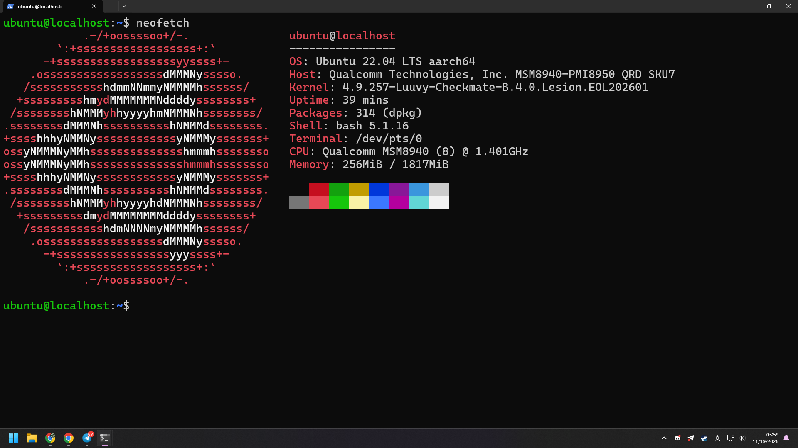

# santoni: headless Ubuntu 22.04 VPS

A Xiaomi Redmi 4X (`santoni`) running keepQASSA Sisu v2.4_0.s (Android 10 / Q)
reduced to a headless server. The Android side exists only to boot the kernel,
bring up Wi-Fi and host an Ubuntu 22.04 arm64 chroot at `/data/ubuntu`, which
starts on every boot with `sshd` listening on port 22.

37 UI APKs are removed from the image, Zygote and SurfaceFlinger are stopped at
boot, and the backlight is turned off. What is left is a 24/7 arm64 Linux box
on hardware that would otherwise sit in a drawer. This is **not** a phone ROM
and **not** vanilla keepQASSA: there is no launcher, no status bar and no
display server, and a missing launcher is not a bug.

---

## Quick Reference

| Key | Value |
|-----|-------|
| **Device** | Xiaomi Redmi 4X (`santoni`) |
| **SoC** | Qualcomm MSM8937 (Snapdragon 435) |
| **Base** | keepQASSA Sisu v2.4_0.s (Android 10 / Q) |
| **Kernel** | Luuvy `C.4.0.eol202601`, prebuilt, Linux 4.9.257 arm64 |
| **SELinux** | Permissive (required by the chroot) |
| **Current release** | [`v1.2`](https://github.com/ziachi/santoni_qassa_ubuntu/releases/tag/v1.2) |
| **Lunch target** | `qassa_santoni-userdebug` |
| **Build command** | `mka installclean && mka qassa` |
| **Signed with** | `vendor/ziachi-keys/releasekey` |
| **Manifest** | `https://github.com/keepQASSA/manifest.git` branch `Q` |
| **Maintainer** | [@kalomakan](https://t.me/kalomakan) / [ziachi](https://github.com/ziachi) |

The kernel is the one component not built from this tree. Its source is not
published, so it is used as a temporary baseline; replacing it with a
self-built, open-source kernel is the next milestone. Everything that runs as
root is in this repository and can be read: `vps-setup/`, the boot scripts, the
Wi-Fi path.

---

## Proof & Resource Footprint



A Windows Terminal session on the LAN, `ssh ubuntu@<device-ip>`, running
`neofetch` inside the chroot on a v1.2 build. The `/dev/pts/0` line is the one
worth reading: it means the session got a real pty, which is the devpts fix
working. A chroot without devpts mounted cannot allocate one, and `ssh -tt`
fails with `PTY allocation request failed on channel 0` even though the password
was accepted.

314 dpkg packages is the whole server. `openssh-server`, `cron`, `iproute2`,
`htop`, `curl`, `git` and the rest of `VPS_PACKAGES` are installed by
`vps-setup`, so `crontab -e` schedules jobs that survive a reboot, `systemctl
is-active` reports the real state, and `sudo reboot` brings the device back with
the chroot and sshd running again. `logrotate` and a weekly `fstrim` run from
`cron` as well, so `/var/log` cannot fill the data partition and the flash is
trimmed on a schedule.


`htop` inside the chroot, 31 minutes after boot, with nothing running: 94 tasks
and 321 threads, 170 MB of 1.77 GB in use, 101 MB of swap, 8 cores on the
`schedutil` governor with 7 of them idle at 0.0%. A chroot shares the PID
namespace, so the list is the Android host's. What matters is what is **not**
there: no `zygote`, no `system_server`, no `app_process`, no `com.android.*`.

| Field | Value |
|---|---|
| Kernel | `4.9.257-Luuvy-Checkmate-B.4.0.Lesion.EOL202601 aarch64` |
| OS | Ubuntu 22.04 LTS aarch64, 314 dpkg packages |
| Memory | 256 MiB of 1817 MiB in use |
| CPU | 8 cores at 1.401 GHz |
| Host (kernel) | Qualcomm MSM8940-PMI8950 QRD SKU7 |
| Shell / terminal | bash 5.1.16 on `/dev/pts/0` |
| Uptime at capture | 39 minutes |

The load average reads 3.24 next to an idle CPU because it counts processes in
uninterruptible sleep, and the Android HAL services sit in that state. The CPU
bars are the honest number for actual work.

The device reports `MSM8937` on the About phone screen where the kernel reports
`MSM8940`. Both are the same Snapdragon 435 family, and the device tree targets
`msm8937`.

---

## Quick Start

From a freshly flashed device to an SSH session:

```bash
# 1. USB: no RSA prompt, adbd is already root
adb devices
adb shell id                      # uid=0(root)

# 2. USB: join Wi-Fi and install Ubuntu 22.04 in one command
adb shell vps-setup "MyWiFi" "MyWiFiPassword"

# 3. note the IP the script prints, then move to Wi-Fi ADB
adb connect <device-ip>:5555

# 4. from any machine on the LAN
ssh ubuntu@<device-ip>
ssh root@<device-ip>
```

Steps 1 and 2 need the cable. After step 2 the device is self-sufficient: it
rejoins Wi-Fi and starts Ubuntu on every boot, so everything after that works
over the network. `vps-setup` sets a random root password and prints it; it is
also stored in `/data/ubuntu_root_pass` (mode 600) if you miss it.

The eight steps `vps-setup` performs, the `wifi` CLI and the troubleshooting
table are in [docs/VPS-SETUP.md](docs/VPS-SETUP.md).

---

## Default Credentials & Security Note

Every account ships with a known default password so a fresh install is
reachable without a console. Change all of them on first login.

| Account | Where | Default password | Change it with |
|---|---|---|---|
| `root` (Ubuntu chroot, SSH port 22) | `ssh root@<device-ip>` | `santoniadmin` | `passwd` |
| `ubuntu` (non-root, `sudo` NOPASSWD) | `ssh ubuntu@<device-ip>` | `ubuntu` | `passwd` |
| ADB over Wi-Fi, port 5555 | `adb -s <device-ip>:5555 shell` | `santoniadmin` | see below |

```bash
# root and ubuntu, over SSH
ssh root@<device-ip>   'passwd'
ssh ubuntu@<device-ip> 'passwd'

# ADB over Wi-Fi: change it over USB, where no password is needed
adb shell "echo 'my-new-password' > /data/adb_wifi_pass && chmod 600 /data/adb_wifi_pass"
```

`vps-setup` accepts `UBUNTU_ROOT_PASS` to override the root default at install
time.

> **Do not leave these defaults in place on a device reachable from a network
> you do not control.** Port 5555 is a root shell and port 22 is root SSH. The
> defaults exist so the first login works, not so they can stay.

**Official source.** The only official source is
**https://github.com/ziachi/santoni_qassa_ubuntu**. A build, ZIP or "repack"
from anywhere else (a Telegram channel, a file host, a mirror, a fork under a
different name) is untrusted. A headless server image is an attractive target:
a modified build can ship a crypto miner or a reverse shell and still boot and
behave normally. Before flashing anything you did not build yourself, check the
commit hash against this repository, verify the SHA256 of the ZIP against the
release notes, and read `vps-setup/`. It is small, and it is the part that runs
as root.

**License.** The repository is Apache-2.0. `vps-setup/` carries its own
source-available terms; see [`vps-setup/LICENSE`](vps-setup/LICENSE).

---

## What's Included & Limitations

| Component | Path | What it does |
|---|---|---|
| `wifi` | `wifi/wifi.sh` | `wpa_cli` + busybox `udhcpc` front-end, replacing `cmd wifi` / `svc wifi` |
| `vps-setup` | `vps-setup/vps-setup.sh` | one-command Wi-Fi join and Ubuntu install |
| `ubuntu-enter` | `ubuntu-enter/` | adb shell wrapper with the Wi-Fi password gate |
| `boot-services` | `vps-setup/rootdir/` | chroot-side boot steps: setuid mounts, cron, CPU governor |
| `logrotate` + `fstrim` | `vps-setup/rootdir/` | daily log rotation and a weekly TRIM, both scheduled by `cron` |
| `suid-mount` | `vps-setup/rootdir/` | re-applies the setuid mounts the chroot needs |
| `systemctl` shim | `vps-setup/rootdir/` | enough of systemd for installers and `is-active` |
| `init.ubuntu.sh` / `.rc` | `rootdir/` | boot script and init service |
| `webcam_bridge` | `webcam-bridge/` | Camera2 NDK to MJPEG (incomplete) |
| `sensor_bridge` | `sensor-bridge/` | `ASensorManager` to a log file |
| `pulse-default.pa` | `audio-bridge/` | PulseAudio config only |

**Limitations.** The kernel is Linux 4.9 with no PID, UTS, IPC or USER
namespaces, so **Docker, LXC and podman cannot run**. Plain `chroot` is fully
supported. `CONFIG_SYSVIPC` and `CONFIG_POSIX_MQUEUE` are also absent, so
PostgreSQL and Redis will not start. The full option table is in
[docs/ARCHITECTURE.md](docs/ARCHITECTURE.md#kernel-capability-check).

---

## Building from Source

Four repositories, cloned into a synced keepQASSA tree:

| Repo | Branch | Clone path |
|---|---|---|
| [santoni_qassa_ubuntu](https://github.com/ziachi/santoni_qassa_ubuntu) | `main` | `device/xiaomi/santoni` |
| [vendor_xiaomi_santoni_qassa](https://github.com/ziachi/vendor_xiaomi_santoni_qassa) | `qassa-ubuntu` | `vendor/xiaomi` |
| [kernel_xiaomi_msm8937_qassa](https://github.com/ziachi/kernel_xiaomi_msm8937_qassa) | `qassa-ubuntu` | `kernel/xiaomi/msm8937` |
| [frameworks_base_qassa](https://github.com/ziachi/frameworks_base_qassa) | `qassa-10` | `frameworks/base` |

```bash
mkdir -p ~/qassa && cd ~/qassa
repo init -u https://github.com/keepQASSA/manifest.git -b Q --depth=1
repo sync -j8 --force-sync --no-tags --no-clone-bundle

source build/envsetup.sh
lunch qassa_santoni-userdebug
mka installclean && mka qassa
```

Output: `out/target/product/santoni/qassa_ubuntu22-ziachi-santoni.zip`, flashed
from TWRP with `adb sideload`. Signing keys (`vendor/ziachi-keys`) are not on
GitHub, so generate your own.

Prerequisites, the webview LFS step, key generation, the build cheat sheet and
the common build errors are in [docs/BUILD.md](docs/BUILD.md). How the image is
assembled (boot sequence, package removal, hardware bridges) is in
[docs/ARCHITECTURE.md](docs/ARCHITECTURE.md).

---

## Documentation

This README is the quick start. The deep-dive reference lives in
[`docs/`](docs/README.md), which indexes the three files below.

| File | Contents |
|---|---|
| [docs/](docs/README.md) | index of the deep-dive reference: what each file answers |
| [docs/BUILD.md](docs/BUILD.md) | full build guide, signing keys, cheat sheet, build errors |
| [docs/ARCHITECTURE.md](docs/ARCHITECTURE.md) | boot sequence, package removal, bridges, kernel options |
| [docs/VPS-SETUP.md](docs/VPS-SETUP.md) | headless mode, `wifi` CLI, ADB access, troubleshooting |
| [CHANGELOG.md](CHANGELOG.md) | one section per change: Problem / Fix / Files / Impact |
| [AGENTS.md](AGENTS.md) | hard rules for AI agents and contributors |

---

## Credits

- [omansh-krishn](https://github.com/omansh-krishn): original keepQASSA device tree for santoni
- [ziachi](https://github.com/ziachi): santoni port, headless VPS conversion, customizations, bug fixes
- Luuvy: the prebuilt kernel (`C.4.0.eol202601`)

---

## Support

If this project helped turn your old Redmi 4X into a useful Linux server, consider supporting ongoing maintenance and open-source kernel development:

* **EVM Wallet (ETH, USDT, USDC, BNB, Polygon, Arbitrum, Base):**
  ```text
  0x00000f96186e865E1708CCC25d0E58088C000000
  ```
